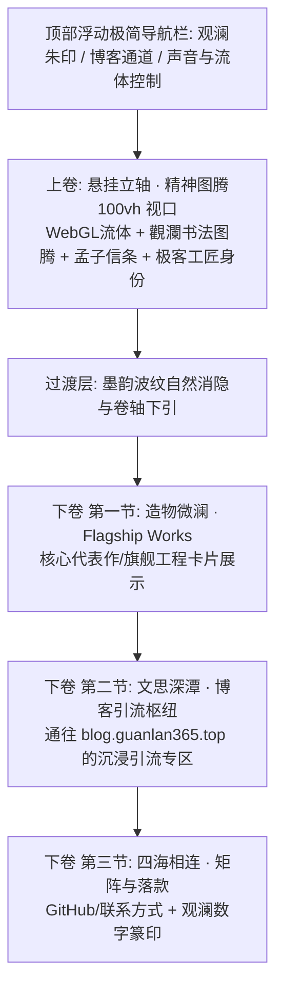

# 观澜个人主页 (`guanlan365.top`) 架构与设计规范

**项目代号**：Guanlan Portal  
**设计日期**：2026-10-09  
**部署域名**：`guanlan365.top`（根域名）  
**关联博客**：`https://blog.guanlan365.top/`  
**核心哲学**：“观水有术，必观其澜；日月有明，容光必照焉。”（《孟子·尽心上》）

---

## 1. 架构定位与业务边界

| 维度 | 个人主页（本项目 `guanlan365.top`） | 观澜博客（`blog.guanlan365.top`） |
| :--- | :--- | :--- |
| **定位** | 个人数字门户、精神图腾、造物陈列、全网连接枢纽 | 知识沉淀池、深度长文排版、Markdown 归档系统 |
| **视觉基调** | 深邃冷峻·极客禅（Neo-Eastern Zen & Fluid Wave） | 文档与长读体验系统 |
| **交互核心** | WebGL GPU 物理水墨流体 + 纵向流动长卷叙事 | 目录跳转、代码高亮、全文阅读 |
| **关系** | 根入口，高质感沉浸引流通道 | 独立子系统，回链个人门户 |

---

## 2. 视觉与交互系统设计

### 2.1 色彩体系（深水墨黑 · 冷潭墨渊）
- **基底黑**：`#06080c`（冷潭墨渊深色），拒绝发灰、拒绝单调无层次的纯黑 `#000000`。
- **墨韵渐变**：`#0a0f16` ~ `#0e1622`（深层水墨流动层次）。
- **冷光高光**：`#94a3b8` / `#e2e8f0`（冷冽水面反光与微弱高光）。
- **黛蓝微澜**：`#1a2a3a` / `#162838`（深水波纹受光面的幽蓝微光）。
- **东方点睛印记**：`#b91c1c` / `#991b1b`（观澜篆刻印章，暗朱砂质感，点缀于顶栏与落款）。

### 2.2 排版与字体规范
- **西文字体**：现代几何无衬线字体（Inter / system-ui）+ 等宽数字与标签（JetBrains Mono / ui-monospace），彰显技术工匠精确感。
- **中文字体**：典雅风骨宋体/明体（Songti SC, STSong, SimSun, Source Han Serif, Noto Serif CJK SC），彰显东方文人意境。

### 2.3 核心流体引擎（Fluid Wave Engine）
- **实现方式**：自研轻量 WebGL 物理流体着色器（Navier-Stokes 方程数值模拟：Advection 对流、Diffusion 扩散、Divergence 散度、Pressure 泊松求解、Vorticity 涡度约束）。
- **输入响应**：
  - 光标滑过产生向外扩散与搅动的墨汁涟漪；
  - 页面纵向滚动驱动流体下沉与涌动，随滚动深度从浓墨渐变为澄澈淡墨。
- **性能优化**：离屏 FBO 渲染，着色器自适应分辨率缩放（移动端 DPR 限制），确保 60fps 满帧运行，零笨重 3D 引擎依赖。

---

## 3. 纵向长卷布局设计（双层递进）



### 3.1 顶部悬浮导航栏（NavBar）
- 左侧：微型篆刻「觀瀾」朱印与拼音 `GUANLAN`；
- 右侧：
  - 「博客」跳转外链标签（带向外流动微光指示 `blog.guanlan365.top`）；
  - 流体交互重置/涟漪开关；
  - 当前时间（以天干地支或纪年与现代时间并置）。

### 3.2 上卷：精神图腾（Hero Section）
- 占据首屏 100vh；
- 背景为深邃冷色水墨流体；
- 居中呈现书法质感「觀瀾」大字，带有微弱浮雕水光；
- 伴随孟子哲理信条：“观水有术，必观其澜；日月有明，容光必照焉。”
- 底部悬浮纵向微澜提示（垂直脉动线与“向下卷阅”指示）。

### 3.3 下卷第一节：造物微澜（Flagship Works）
- 水墨半透明微磨砂卡片（Ink Glassmorphism）；
- 展示个人代表性旗舰项目（如：算法/AI、全栈架构、极客工具等）；
- 卡片包含：技术栈微标签、项目哲学简介、代码仓库/在线演示跳转。

### 3.4 下卷第二节：文思深潭（Blog Nexus）
- 专属打造的观澜博客引流通路；
- 文案呈现博客定位：“立文字以明道，蓄深潭而行舟”；
- 醒目的高质感入场卡片，直达 `https://blog.guanlan365.top/`。

### 3.5 下卷第三节：四海相连与落款（Footer & Seal）
- GitHub、Mail、社交网络图标与链接；
- 底部居中大印：朱砂印章「觀瀾印」SVG 矢量印模；
- 极客禅版权落款：`© 2026 GUANLAN · guanlan365.top · ALL RIGHTS RESERVED`。

---

## 4. 技术栈选型与项目结构

- **框架与构建**：Vue 3 (Composition API, `<script setup>`), TypeScript (strict mode), Vite 6
- **样式与动画**：TailwindCSS / 手写细致水墨微特效 CSS 变量
- **图形渲染**：原生 WebGL 2.0 / WebGL 1.0 回退着色器管线（纯原生编写，零冗余重度三方库）
- **图标系统**：轻量内联 SVG 图标系统
- **目录规划**：
  ```
  src/
  ├── assets/          # 字体、书法矢量及静态纹理
  ├── components/      # 界面组件
  │   ├── Navbar.vue
  │   ├── FluidBackground.vue  # WebGL 流体画布
  │   ├── HeroSection.vue      # 上卷·精神图腾
  │   ├── WorksSection.vue     # 下卷·旗舰造物
  │   ├── BlogSection.vue      # 下卷·博客引流
  │   └── FooterSection.vue    # 下卷·落款印章
  ├── gl/              # WebGL 流体数学与着色器
  │   ├── shaders/     # GLSL 顶点/片元着色器 (advection, splat, display等)
  │   ├── fluid.ts     # 物理模拟控制器
  │   └── gl-utils.ts  # WebGL 上下文与 FBO 管理
  ├── data/            # 站点内容、造物项目与外链数据配置
  ├── App.vue          # 根装配组件
  └── main.ts          # 入口
  ```

---

## 5. 验收标准与验证策略
1. **视效验证**：水墨物理流体流畅度稳定在 60fps，鼠标滑过有明显的涟漪散逸效果，无卡顿。
2. **美学验证**：符合深玄暗墨、黛蓝微澜的“深邃冷峻·极客禅”气场，无模板化生硬色块。
3. **响应式验证**：完美适配桌面大屏、笔记本、平板与手机竖屏滑动浏览。
4. **功能验证**：博客外链正确指向 `https://blog.guanlan365.top/`，各外链与交互正常。
5. **构建验证**：`pnpm run build` / `npm run build` 成功无类型报错，产物体积精简。
